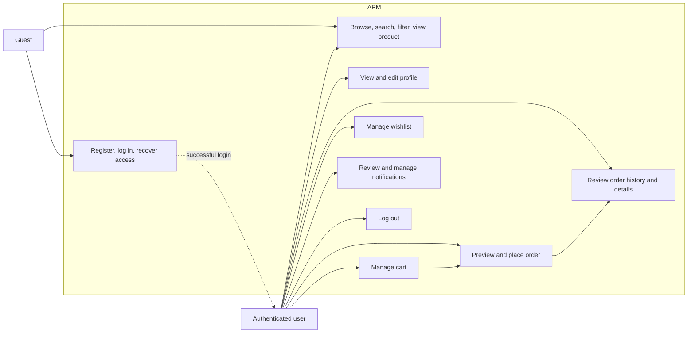
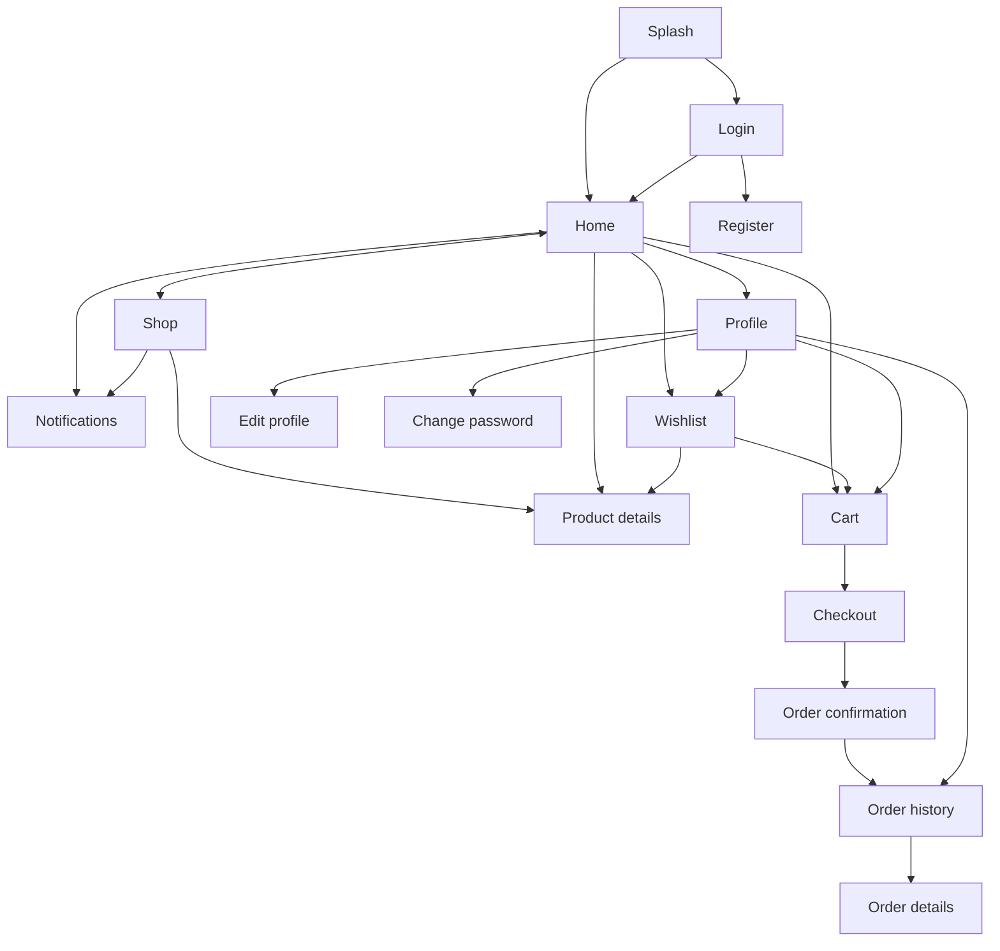

# Requirements and use cases

What APM must do (the requirements) and how people use it (the use cases).

## Project requirements

### 1. Project Overview

The project is a mobile e-commerce application that allows users to discover products, manage a cart
and wishlist, place and review orders, and receive shopping and order notifications.

This document records the current high-level requirements. Detailed behavior is maintained in the linked feature specifications.

### 2. Project Objectives

- Provide a modern, clean, and user-friendly mobile interface.
- Provide clear and smooth navigation between the application's screens.
- Support the primary customer journey from account access through product discovery and ordering.
- Contain at least 20 screens/pages when the complete project scope is delivered.

### 3. Project Scope

#### 3.1 Current Scope

- User authentication and account registration
- User profile viewing and editing
- Product discovery, search, filtering, and details
- Shopping cart and wishlist management
- Checkout, order confirmation, order history, and order details
- In-app notifications for order and shopping updates

#### 3.2 Deferred Scope

The following required features will be specified in a later phase:

- Settings
- About application
- Contact information

#### 3.3 Out of Scope

No feature has been declared permanently out of scope yet.

### 4. User Roles

#### 4.1 Guest

A user who has not authenticated. A guest can open authentication screens and browse/search/filter
the public catalog. Cart, wishlist, checkout, orders, profile, and notifications require sign-in.

#### 4.2 Authenticated User

A registered and signed-in customer who can use all features in the current scope. All personal
resources are restricted to their owner.

### 5. Feature Requirements

Detailed requirements are maintained in the [features directory](features.md).

- [Authentication](features.md#authentication)
- [User profile](features.md#user-profile)
- [Product catalog](features.md#product-catalog)
- [Shopping cart](features.md#shopping-cart)
- [Wishlist](features.md#wishlist)
- [Orders and checkout](features.md#orders-and-checkout)
- [Notifications](features.md#notifications)

### 6. Screen Inventory

Actions such as adding an item, changing its quantity, and removing it from the cart are behaviors rather than separate screens.

| ID | Screen | Feature | Status |
|---|---|---|---|
| SCR-001 | Splash | Authentication | Current scope |
| SCR-002 | Login | Authentication | Current scope |
| SCR-003 | Register | Authentication | Current scope |
| SCR-004 | Forgot password | Authentication | Removed; signed-in users change their password from Profile |
| SCR-005 | User profile | User profile | Current scope |
| SCR-006 | Edit profile | User profile | Current scope |
| SCR-007 | Home | Product catalog | Current scope |
| SCR-008 | Product categories | Product catalog | Current scope |
| SCR-009 | Product list | Product catalog | Current scope |
| SCR-010 | Product details | Product catalog | Current scope |
| SCR-011 | Search products | Product catalog | Current scope |
| SCR-012 | Product filtering | Product catalog | Current scope; bottom sheet |
| SCR-013 | Shopping cart | Shopping cart | Current scope |
| SCR-014 | Wishlist/favorites | Wishlist | Current scope |
| SCR-015 | Checkout | Orders | Current scope |
| SCR-016 | Order confirmation | Orders | Current scope |
| SCR-017 | Order history | Orders | Current scope |
| SCR-018 | Order details | Orders | Current scope |
| SCR-019 | Notifications | Notifications | Current scope |
| SCR-020 | Settings | Additional features | Deferred |
| SCR-021 | About application | Additional features | Deferred |
| SCR-022 | Contact information | Additional features | Deferred |

The current scope defines 19 screens. The three deferred screens bring the complete requirement to
22 screens, satisfying the minimum of 20.

### 7. System-wide business rules

#### 7.1 Accounts and sessions

- Email and password are the v1 credentials.
- Email comparison is case-insensitive.
- Passwords contain at least 8 characters and are stored only as one-way hashes.
- Access tokens last 15 minutes; refresh tokens last 7 days. Refreshing issues a new pair without
  invalidating earlier unexpired pairs; logout invalidates all tokens for the account.
- Registration signs the user in immediately. Email verification is deferred.
- Signed-in users change their password from Profile by entering the current one. The change signs
  out every other device. Password recovery for signed-out users (email reset) is out of scope.

#### 7.2 Shopping ownership

- Catalog browsing is public.
- Cart and wishlist require authentication in v1.
- Each user has one current cart and one wishlist collection.
- Guest persistence and guest-to-account merging are deferred.

#### 7.3 Pricing and currency

- V1 uses USD.
- Product and cart prices use the current catalog price.
- The server calculates all totals; client totals are never trusted.
- Order items and order totals are stored as checkout-time snapshots.
- Discounts and tax are not applied in v1.

#### 7.4 Stock

- Available quantity is a non-negative whole number.
- Cart quantity is at least one and cannot exceed currently available quantity.
- Cart validation is informational; order placement validates stock again and decrements it in the
  same transaction.
- Inventory reservation and back-ordering are deferred.

#### 7.5 Checkout and orders

- Checkout requires an authenticated user and a non-empty valid cart.
- V1 delivery uses one recipient name, email, and free-form address.
- Standard delivery is 2–4 business days with a flat USD 4.00 fee.
- Cash on delivery is the only production v1 payment method. Card remains prototype-only.
- Order creation requires an idempotency key to prevent duplicates.
- The v1 status flow is `pending → confirmed → shipped → delivered`.
- Cancellation, returns, refunds, and user-driven status changes are deferred.

#### 7.6 Notifications

- Notifications belong to one authenticated user.
- A notification may be read, marked read, or cleared from the user's inbox.
- V1 notification types are `order`, `offer`, and `stock`.
- Push delivery and notification preferences are deferred; v1 is an in-app inbox.

### 8. Non-Functional Requirements

#### 8.1 Usability

- The interface must be modern, clean, and user-friendly.
- Navigation labels and controls must be clear and consistent.
- Important actions must provide visible feedback.
- Loading, empty, success, validation, and error states must be represented where applicable.

#### 8.2 Responsive layout

- Flutter screens target Android and iOS phones in portrait orientation.
- Layouts support widths from 360 logical pixels upward without clipped primary actions.

#### 8.3 Accessibility

- Interactive controls must expose semantic labels and support screen readers.
- Text and controls must meet WCAG 2.1 AA contrast targets.
- Touch targets must be at least 44 × 44 logical pixels where platform controls allow it.

#### 8.4 Performance and security

- Product and order list endpoints are paginated and cap page size at 100.
- Secrets and credentials must not appear in source control, logs, or API responses.
- Personal resources must be queried using the authenticated owner scope.
- Loading and mutation actions must prevent accidental duplicate submission.

### 9. Assumptions and Constraints

- The current requirements describe a customer-facing mobile application.
- The prototype will use mock data and will not provide real authentication, payment, or order processing.
- Settings, about, contact, card processing, push notifications, email delivery, guest shopping,
  cancellation, returns, tax, and discounts are deferred from v1.

### 10. System-Wide Acceptance Criteria

- All approved screens can be reached through a clear navigation path.
- Each approved feature includes its required normal, loading, empty, and error states where applicable.
- The final application contains at least 20 distinct screens/pages.
- Feature behavior matches the approved feature specifications.
- The primary journey works end to end: register/login → browse → cart → checkout → confirmation →
  order history/details.
- An authenticated user can review, mark, and clear in-app notifications.

## Use cases

### 1. Overview

This document defines the user interactions in the v1 customer-facing e-commerce application. It is
the behavioral bridge between [project requirements](#project-requirements), feature specifications, the
prototype, and API contracts.

### 2. Actors

| Actor | Description |
|---|---|
| Guest | An unauthenticated visitor who can access account flows and browse the public catalog. |
| Authenticated user | A registered customer with access to profile, cart, wishlist, checkout, orders, and notifications. |
| System | The backend services that validate identity, pricing, stock, ownership, and order state. |

### 3. Use-case diagram

### 4. Use-case summary

| ID | Use case | Actor | Outcome |
|---|---|---|---|
| UC-001 | Start application | Guest or authenticated user | User reaches login or home according to session state. |
| UC-002 | Register | Guest | Account is created and the user is signed in. |
| UC-003 | Log in | Guest | Valid credentials create an authenticated session. |
| UC-004 | Change password | Authenticated user | The password is replaced; other devices are signed out. |
| UC-005 | Browse and search products | Guest or authenticated user | Matching visible products are displayed. |
| UC-006 | View product details | Guest or authenticated user | Product details and current stock are displayed. |
| UC-007 | Manage profile | Authenticated user | Current profile is viewed or updated. |
| UC-008 | Manage cart | Authenticated user | Eligible products and quantities are added, changed, or removed. |
| UC-009 | Manage wishlist | Authenticated user | Products are saved or removed. |
| UC-010 | Preview checkout | Authenticated user | Delivery input, cart, stock, and totals are validated. |
| UC-011 | Place order | Authenticated user | One order is created and confirmation is displayed. |
| UC-012 | Review orders | Authenticated user | Owned order history and details are displayed. |
| UC-013 | Manage notifications | Authenticated user | Notifications are reviewed, marked read, or cleared. |
| UC-014 | Log out | Authenticated user | All account tokens are revoked and login is displayed. |

### 5. Detailed use-case flows

#### UC-001 — Start application

**Precondition:** The application is installed or opened in a supported environment.

**Main flow:**

1. The user opens the application.
2. The splash screen appears while local session state is checked.
3. If a refresh session exists, the system attempts to restore the session.
4. The application opens Home for a valid session or Login otherwise.

**Alternative flow:** If the service is unavailable, the application shows a retryable error and does
not assume the user is authenticated.

#### UC-002 — Register

**Precondition:** The actor is a guest.

**Main flow:**

1. The guest opens Register from Login.
2. The guest enters name, email, password, and password confirmation.
3. The application validates required fields, email format, password length, and matching passwords.
4. The system creates the account when the normalized email is unused.
5. The system creates an access token and refresh session.
6. The application opens Home.

**Alternative flows:**

- An existing email returns `EMAIL_ALREADY_REGISTERED`; the form remains populated except passwords.
- Invalid input is shown beside the relevant fields.

#### UC-003 — Log in

**Precondition:** The actor has an active account.

**Main flow:**

1. The guest enters email and password.
2. The application disables repeated submission and shows progress.
3. The system validates the credentials without revealing which value was wrong.
4. The system returns an access token, refresh token, and user profile.
5. The application opens Home.

**Alternative flows:** Invalid credentials keep the user on Login; a disabled account displays an
account-disabled message; service failure preserves the email and permits retry.

#### UC-004 — Change password

1. The user opens Profile and selects Change password.
2. The user enters the current password, a new password, and its confirmation.
3. The application validates the fields and submits them.
4. The system checks the current password, saves the new one, revokes every earlier token, and
   returns a new token pair for this device.
5. The application closes the popup and confirms the change.

A wrong current password keeps the popup open with an error on that field. There is no password
recovery for signed-out users.

#### UC-005 — Browse and search products

1. The actor opens Home or Shop.
2. The system returns visible products and active categories.
3. The actor optionally enters a search query, selects a category, availability filter, or sort.
4. The application displays the matching page or a no-results state.
5. The actor may clear filters or select a product.

#### UC-006 — View product details

1. The actor selects a product card.
2. The application displays name, category, price, rating when present, current available quantity,
   image when present, and description when present.
3. Quantity begins at one and cannot exceed available stock.
4. A product with zero available quantity cannot be added to the cart.

#### UC-007 — Manage profile

**Precondition:** The actor is authenticated.

1. The user opens Profile and selects Edit profile.
2. The application shows current name, email, and optional phone.
3. The user changes approved fields and saves.
4. The system validates uniqueness and formatting, then returns the updated profile.
5. The profile screen reflects the saved values.

Canceling edit discards unsaved changes.

#### UC-008 — Manage cart

**Precondition:** The actor is authenticated.

1. The user adds an in-stock product from Home, Shop, Product details, or Wishlist.
2. The system adds a new cart line or increases its existing quantity.
3. The header and navigation cart badges update to the total quantity.
4. The user may set a valid quantity or remove a line.
5. The system returns the complete cart with recalculated current-price totals.

**Alternative flows:** Out-of-stock or insufficient-stock changes are refused without corrupting the
existing cart. An empty cart displays a route back to Shop.

#### UC-009 — Manage wishlist

**Precondition:** The actor is authenticated.

1. The user saves an eligible product from a product surface.
2. The product appears once in the wishlist; saving it again does not create a duplicate.
3. The user may open the product or remove it from the wishlist.
4. An empty wishlist displays a route back to Shop.

#### UC-010 — Preview checkout

**Precondition:** The user is authenticated and the cart is not empty.

1. The user opens Checkout from the cart.
2. The user enters recipient name, delivery email, and delivery address.
3. The system revalidates product availability and current prices.
4. The system returns subtotal, USD 4.00 standard-delivery fee, and total.
5. The application presents the final summary before order submission.

Cash on delivery is the v1 production method. Card selection in the prototype is demonstrative only.

#### UC-011 — Place order

**Precondition:** UC-010 succeeds.

1. The user selects Place order once.
2. The application sends a unique idempotency key and disables repeated submission.
3. In one transaction, the system validates stock, creates the order and immutable item snapshots,
   decrements stock, and removes purchased cart items.
4. The system returns the created `pending` order.
5. The application opens Order confirmation.

**Alternative flows:** If stock changed, the order is not created and the user returns to a
recoverable checkout state. Repeating the same request does not create a second order.

#### UC-012 — Review orders

1. The user opens Order history from Profile or Order confirmation.
2. The system returns the user's orders newest first.
3. The user selects an order card.
4. The system returns that owned order and its item, delivery, payment, total, and status snapshots.
5. The application displays Order details.

An absent order and another user's order both return `ORDER_NOT_FOUND`.

#### UC-013 — Manage notifications

1. The user selects the notification indicator on Home or Shop.
2. The system returns visible notifications newest first and the unread count.
3. The user may filter to unread notifications.
4. The user may mark one or all notifications as read.
5. The user may clear the inbox.
6. The screen updates the unread count and empty state immediately.

#### UC-014 — Log out

1. The user selects Sign out from Profile.
2. The system revokes all access and refresh tokens issued to the account.
3. The application removes local tokens and returns to Login.

### 6. Navigation map

### 7. Cross-cutting alternate flows

- **Unauthenticated access:** Protected screens redirect to Login and preserve the intended
  destination where practical.
- **Expired access token:** The client performs one refresh attempt, retries the original request once,
  and returns to Login if refresh fails.
- **Offline/service failure:** Preserve recoverable input, show a clear error, and offer retry.
- **Empty result:** Show a feature-specific empty state and a useful next action.
- **Duplicate action:** Disable mutation controls while pending; order creation also uses server-side
  idempotency.
- **Ownership failure:** Return the area's `*_NOT_FOUND` code without revealing another user's data.
